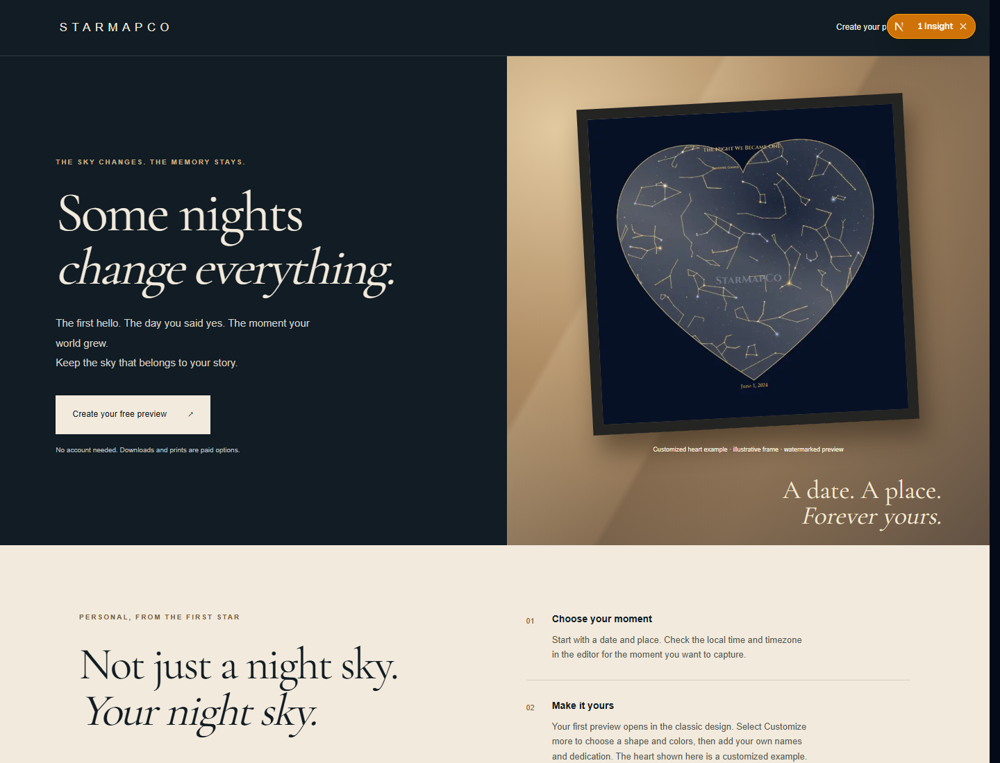

# Luxury campaign review — issue 661

Review-only local implementation; no production deployment or spend. Route: `/a/meaningful-night`. Branch: `feat/661-luxury-campaign`. Noindex is not access control; do not publicly deploy this draft.

## Page visual review

Grok Bot is the owner's requested primary visual reviewer; Muse/Jack provides the secondary pass. Both should inspect this exact branch and these screenshots, identify the commit reviewed, and return blocking findings separately from preferences. A request is not acceptance or approval.

[Full mobile page](mobile.jpg) · [Editor handoff](editor-handoff.jpg)

Inspect hierarchy, distinctive typography, phone readability, spacing, contrast, product realism, free-preview versus paid-product clarity, FAQ discoverability, and consistency with the existing luxury ad. The orange Next.js development badge is local tooling, not page content.

## Ad visual review

Current video: [seq-18.1](https://invideo.io/@starmapco/starmapco-a-date-worth-keeping-fresh-growth-test/notebook/seq-18.1), T4 rev59, 15 seconds, 1080x1920. Current still: [seq-17.1](https://invideo.io/@starmapco/starmapco-a-date-worth-keeping-fresh-growth-test/notebook/seq-17.1). Preserve the owner-loved luxury direction. Do not review superseded seq16 or v08 as current.

[Opening](ad-opening.jpg) · [Cut frame](ad-cut.jpg) · [End](ad-end.jpg)

Inspect the exact exported video, including audio, first two seconds, frame/composite seams, 7-second hard cut, watermark/mockup honesty, mobile CTA legibility and platform overlay zones. Screenshots alone cannot validate motion or audio. If access fails, report the blocker rather than a pass. No paid generation or public uploads.

## Browser journey check

Local campaign submission with date 2024-06-01 and selected Santorini result transferred mode=quick, source=meaningful-night, date, coordinates and Europe/Athens timezone. The editor rendered a preview; Customize more showed June 1, 2024 at 9 PM in Europe/Athens. Empty submission opens the editor with place required before generation. Narrow viewport checks at 390 and 320 outer width showed no horizontal document overflow (375/305 CSS content widths).

### Re-verification — 2026-11-21 (Cursor)

- Landing honesty copy live on local `127.0.0.1:3017/a/meaningful-night`: classic-start wording, customized-heart figcaption, blank-time → 9 PM note.
- Date then location handoff: `date=2024-06-01`, picked Santorini coords, `tz=Europe/Athens`, `source=meaningful-night`.
- Customize more: DateTimeControls shows **21:00** with label “optional; cleared time defaults to 9 PM” (no longer blanks the default).
- User-set time then location change: Athens **15:30** → Paris **14:30** with date still 2024-06-01. This is **intended instant preservation** (EEST→CEST), not an input-loss bug.
- Fresh screenshots: `desktop-fullpage-2026-11-21.png`, `desktop-viewport-2026-11-21.png`, `mobile-fullpage-2026-11-21.png`, `mobile-viewport-2026-11-21.png`, `editor-handoff-review-2026-11-21.png`.
- Name-only/noon vs cleared-time 9 PM contracts left unchanged in code; landing copy now states the editor’s blank-time 9 PM behavior.

### Grok CHANGES NEEDED follow-up — 2026-11-23 (Cursor)

Addressed Grok Bot review of `f83505bb` (issuecomment-7083038319) with synthetic local browser checks only. No merge/deploy/spend.

1. **Title/place handoff:** URL + landing handoffs now sync place into subtitle and date into dedication from classic defaults. Classic title keeps **Our Night Sky** with inline label “Default title — change it in Customize more.”
2. **Hero watermark / date legibility:** Heart watermark home biased lower (`preferredCenterYRatio` 0.58). Campaign `heart-preview.png` regenerated with Cormorant date line. Classic dedication default switched to Cormorant 32 for readable synced dates.
3. **Proof gap closed:** date-first, place-first, and Customize-more time (`21:00` + cleared-time 9 PM wording) captured.

Fresh proofs (2026-11-23):
- `desktop-fullpage-2026-11-23.png`, `desktop-viewport-2026-11-23.png`
- `mobile-fullpage-2026-11-23.png`, `mobile-viewport-2026-11-23.png`
- `editor-date-first-2026-11-23.png`, `editor-date-first-time-2026-11-23.png`
- `editor-place-first-2026-11-23.png`, `editor-place-first-time-2026-11-23.png`
- `editor-url-handoff-2026-11-23.png`, `editor-url-handoff-time-2026-11-23.png`
- Machine-readable: `handoff-verification-2026-11-23.json`

Ad creative (seq-18.1 / seq-17.1) unchanged — still Grok’s lane; no paid re-export.

## Validation

- Node 22.23.5. Initial and final `tsc --noEmit` passed.
- ESLint: zero errors, 17 existing warnings on initial run.
- Targeted tests: 56/56 pass with TZ=UTC (preview navigation/location, shipping labels/disclosures, timezone default).
- Full unit suite: 3137 pass, 18 fail on Windows. Failures include Windows ESM paths, CRLF source assertions, npm.cmd spawning, and a default-time test assuming UTC. The latter passes under UTC. Other failures are not waived; CI is the authoritative validator.
- Changed-file ESLint passed with no warnings or errors.
- Production build initially compiled and generated pages but exited at a Next.js security-upgrade reminder. Standard `npm run build` retry passed; the dependency advisory remains a separate release concern and was not suppressed or fixed by this page change.

## Launch gates

No merge, deployment, publication, billing changes or spending authorized here. Owner must see final ads and exact campaign and approve. CAD100 is the total ceiling including fees/taxes/FX, not an instruction to spend it. Muse reports an earlier CAD30 first-tranche constraint: preserve that lower initial limit pending owner's final campaign decision. Never use Meta account ending 9216 or its attached payment methods.

Still unresolved: Etsy listing/tag quality and dispatch-origin consistency; organic creative audition; enforceable paid-test stop and owner; approved billing account; actual fulfillment and paid-order attribution verification; independent current creative reviews. These are separate from visual polish.

## Safe product development

Keep product experiments on isolated branches/local previews with synthetic data and test-mode integrations. Avoid production credentials, real order writes and automatic deployment. Prioritize observed friction in personalization, preview accuracy, product choice and checkout clarity before adding more options. Review improvements individually; release only with owner approval and a rollback plan. Grok leads visual regression review, Muse supplies the second opinion.
