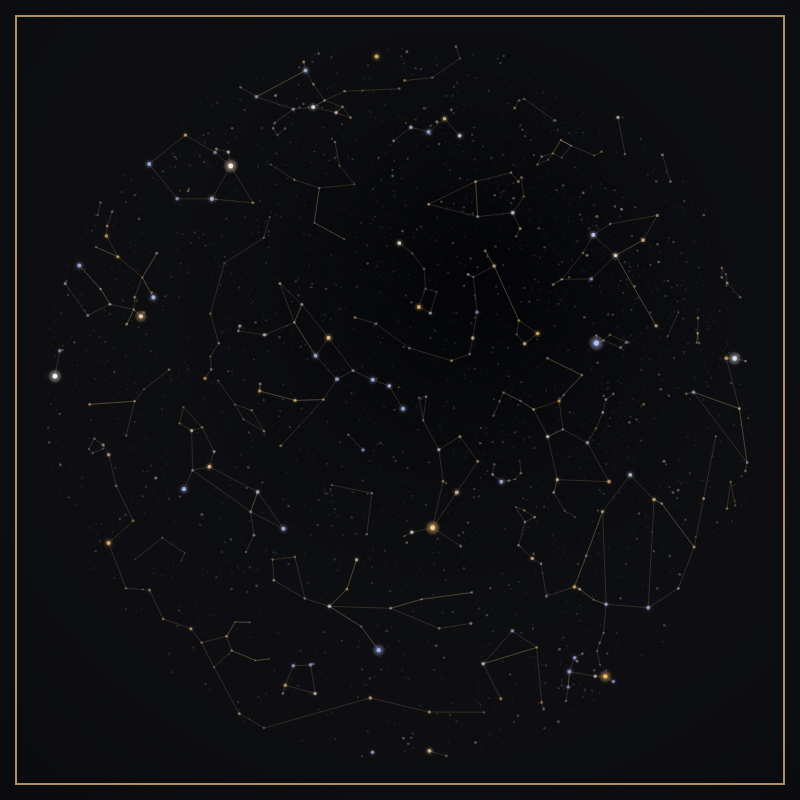
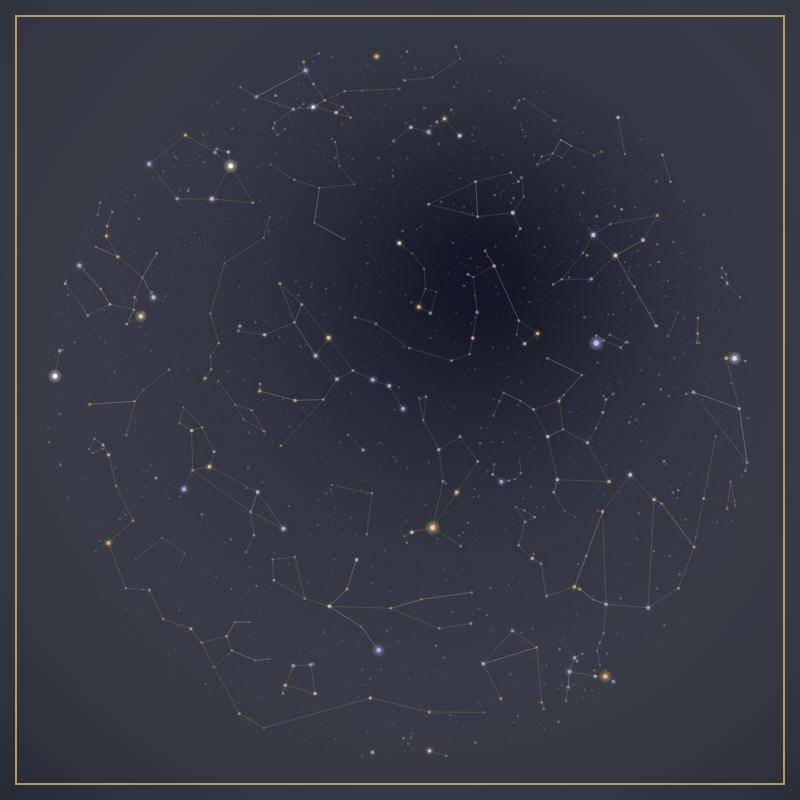
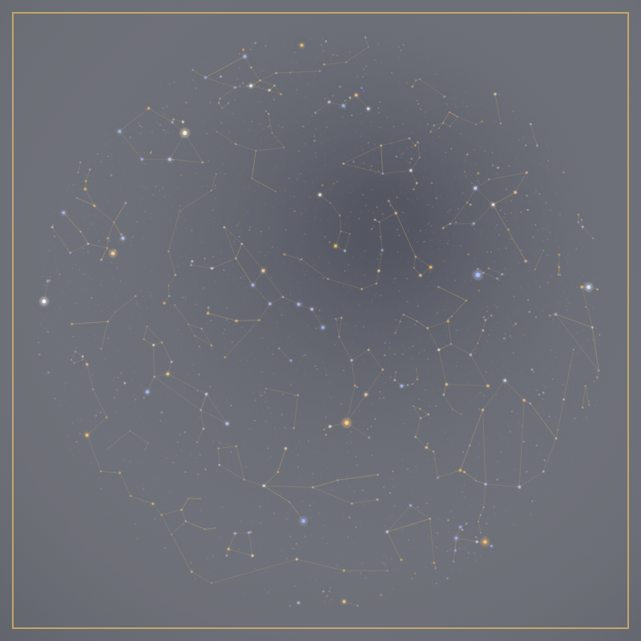

# Bortle sky-darkness comparison

The Advanced customizer has a Bortle class slider from 1 to 9 in half-class steps, defaulting to 4.5. Low values darken the backing; high values add a light wash. This is an artistic light-pollution control, not a simulation of which stars an observer could see.

| Class | Appearance | Mean RGB channel value (0–255) |
| --- | --- | --- |
| 1 | Darkest backing | 16.02 |
| 4.5 | Historical default, unchanged | 57.80 |
| 9 | Bright city-sky wash | 111.94 |

These are real `renderStarMap` canvas outputs rendered locally with `@napi-rs/canvas` (temporary validation tooling, no project dependency). Fixture: London (51.5, −0.12), 2024-06-01T21:00:00Z, navyGold, 800×800, export quality, default render options, no text or watermark. The class 4.5 image was compared byte-for-byte with the same fixture rendered by main revision `54c8f533c9e4cf647d1fdc2ff9f466adb4beb8dd`: **zero changed RGBA channels**.

The permanent `scripts/unit/bortleSky.test.mjs` regression suite records the actual renderer's canvas commands, pins the pre-control main command hash, and verifies that only a background fill is added at 1 and 9 across all four styles. All remaining commands, including star positions, radii and opacity, are identical. Catalogue computation remains fixed at 4.5.

The Bortle test in `tests/premium-rendering.spec.ts` exercises the slider, brightness changes and exact pixel restoration in Chromium. Local execution was blocked because Chromium was absent and the environment network policy denied the Playwright browser download (403 Domain forbidden). The images above are canvas renders, not browser UI screenshots.
